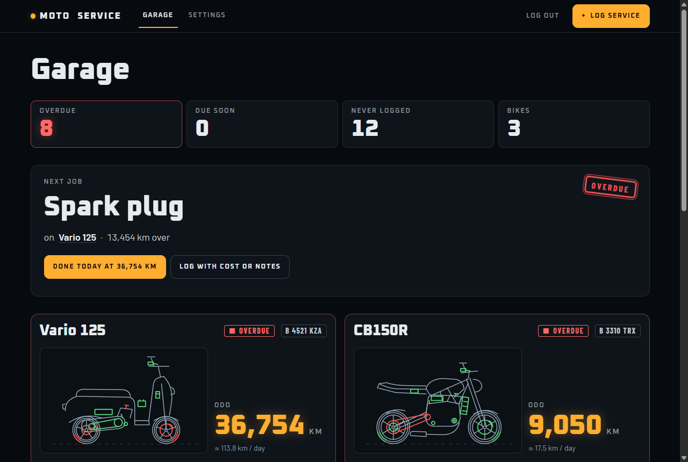
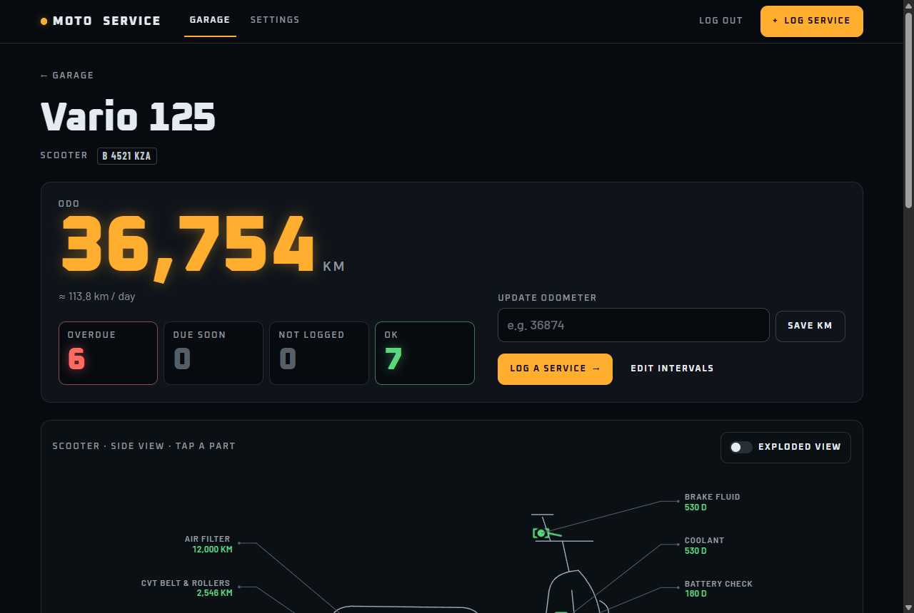
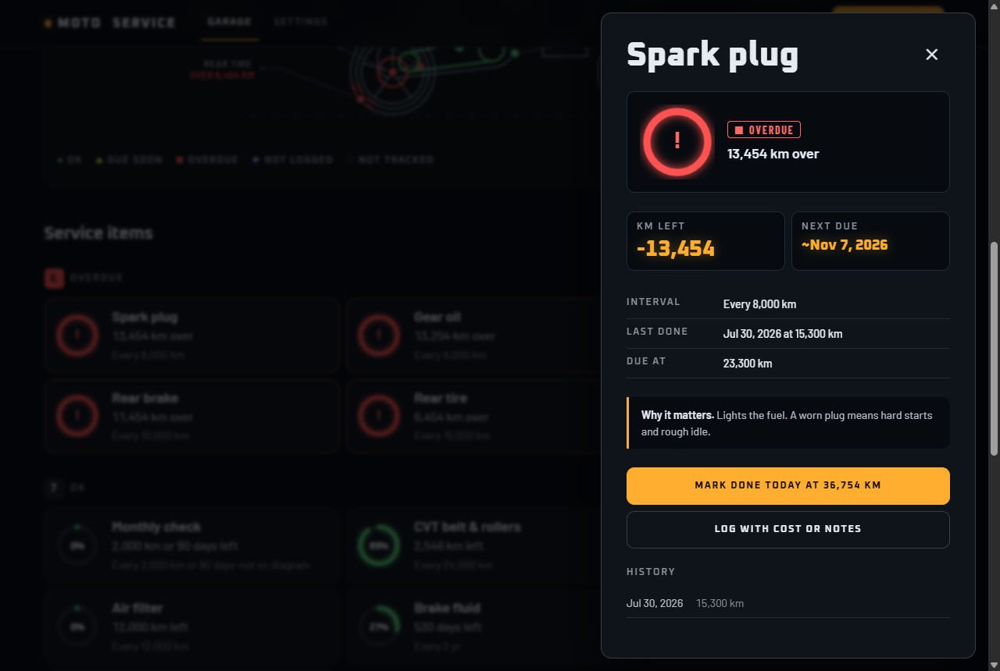
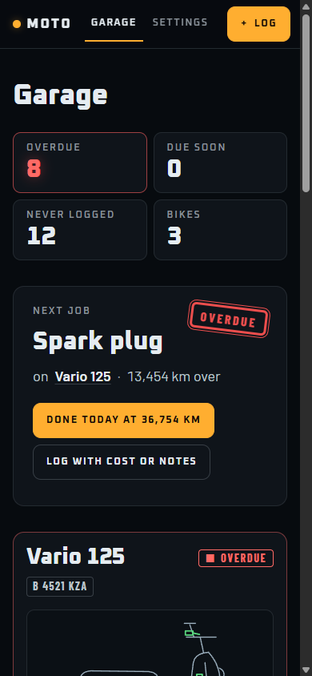
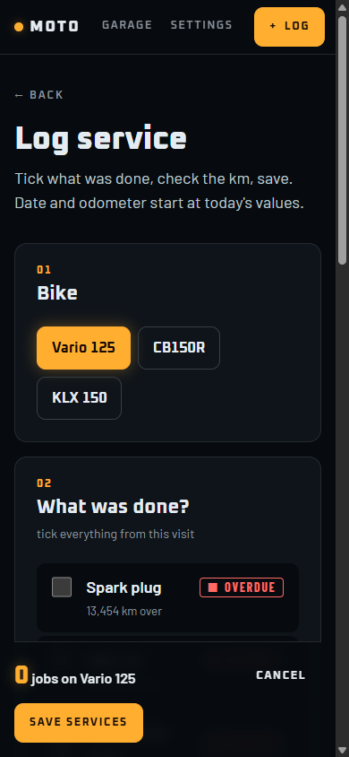

<div align="center">

# Moto Service

**Know what your bike needs next.**

A self-hosted motorcycle service tracker. Log oil changes, parts and kilometres. Each job is tracked by **km and by date, whichever comes first**, so nothing slips.




</div>

## Features

- **Several bikes, several riders.** Anyone can sign up. Every rider only ever sees their own bikes.
- **Due by km or date, whichever comes first.** Each service item is shown as OK, due soon, overdue or never logged. The predicted due date is based on how much you ride.
- **Interactive bike diagram.** Scooter, underbone, sport and trail line drawings. Tap a part to see its status and history, or switch to the exploded view.
- **One-tap "Done".** Marking a job done updates instantly and gives you a few seconds to undo it.
- **Service book.** Every workshop visit is kept with its date, km, cost and notes.
- **Odometer tracking.** Average km per day is worked out from your readings.
- **Sensible defaults.** A new bike comes with common service intervals for its type (oil, filters, chain or CVT belt, brakes and more). You can edit them all.
- **Your data is yours.** Export everything as JSON at any time.
- **Mobile first.** Installable as a PWA, and works one-handed in the workshop.

<p align="center">
  
  
</p>
<p align="center">
  
  
</p>

## Tech stack

| Layer    | Tools                                                         |
| -------- | ------------------------------------------------------------- |
| Backend  | FastAPI, SQLAlchemy 2, Alembic, argon2 password hashing        |
| Database | PostgreSQL 16                                                 |
| Frontend | Svelte 5 + Vite (single-page app, hash router, inline SVG)    |
| Deploy   | Docker Compose, Caddy (automatic HTTPS)                       |

## Quick start (Docker)

You need [Docker](https://docs.docker.com/get-docker/) with Compose.

```bash
git clone https://github.com/Tamlica/moto-service.git
cd moto-service
cp .env.example .env        # set SECURE_COOKIE=0 to try it over plain http
docker compose up -d --build
```

Open <http://localhost:8000> and create an account.

## Self-hosting on a VPS

1. Point your domain's DNS A record at the server.
2. Copy `.env.example` to `.env`, then set:
   - `POSTGRES_PASSWORD`: a long random string
   - `DOMAIN`: e.g. `moto.example.com`
   - `SECURE_COOKIE=1`
3. Start the full stack, including Caddy:

   ```bash
   docker compose --profile prod up -d --build
   ```

Caddy gets the HTTPS certificate automatically. Database migrations run every time the app container starts.

**Backups:** the backup and restore commands (a `pg_dump` cron line) are in the comments at the top of [`docker-compose.yml`](docker-compose.yml).

### Configuration

| Variable            | Required | Description                                                      |
| ------------------- | -------- | ---------------------------------------------------------------- |
| `POSTGRES_PASSWORD` | yes      | Password for the `moto` database user                            |
| `DOMAIN`            | prod     | Public domain Caddy serves and gets a certificate for            |
| `SECURE_COOKIE`     | no       | `1` (default) sends the session cookie only over HTTPS. Use `0` for local http |

## Development

Requirements: Python 3.12, Node 22, Docker (for Postgres).

```bash
cp .env.example .env                   # set SECURE_COOKIE=0
docker compose up -d db

python -m venv .venv
source .venv/bin/activate              # Windows: .venv\Scripts\activate
pip install -r requirements.txt pytest httpx
alembic upgrade head
SECURE_COOKIE=0 uvicorn app.main:app --reload     # API on :8000

cd frontend
npm install
npm run dev                            # UI on :5173, proxies /api to :8000
```

### Tests

The tests use a separate `moto_test` database in the same Postgres container:

```bash
docker compose exec db psql -U moto -c "CREATE DATABASE moto_test"   # once
python -m pytest
```

### Project layout

```
app/
  main.py       FastAPI routes, default service intervals, static file serving
  db.py         SQLAlchemy models and session
  auth.py       password hashing, session cookie, login rate limit
  due.py        due-status and km/day prediction logic (pure, unit tested)
alembic/        database migrations
frontend/src/
  pages/        Garage, Bike, LogService, NewBike, Settings, Login
  lib/          shared components (Gauge, PartPanel, Schematic, Nav, …)
  bikes/        line art for the four bike types
  tokens.css    design tokens: every colour, font and spacing value
tests/          pytest suite (due logic + API)
design.md       the design system
```

### Good to know

- **Ownership checks:** every bike route goes through `get_owned_bike()` in `app/main.py`. Another user's bike returns 404.
- **Single worker:** the login rate limit is kept in memory (`app/auth.py`), so run one uvicorn worker. The Dockerfile already does this.
- **Bike diagrams:** the artwork in `frontend/src/bikes/index.js` can be replaced freely, as long as the part `id`s stay the same.
- **Styling:** use the tokens in `frontend/src/tokens.css` instead of hard-coded colours or fonts. See [`design.md`](design.md).

## Roadmap

- [ ] Password reset by email
- [ ] Email or push reminders when a service is due
- [ ] Photo receipts
- [ ] Sharing a bike between accounts
- [ ] Cost charts

Ideas and pull requests are welcome.

## Contributing

1. Fork the repo and create a branch: `git checkout -b my-change`.
2. Make your change. Add or update tests for backend logic.
3. Run `python -m pytest` and `npm run build` in `frontend/`.
4. Open a pull request describing what changed and why.

For bigger changes, please open an issue first so we can talk it through.

## License

[MIT](LICENSE)
